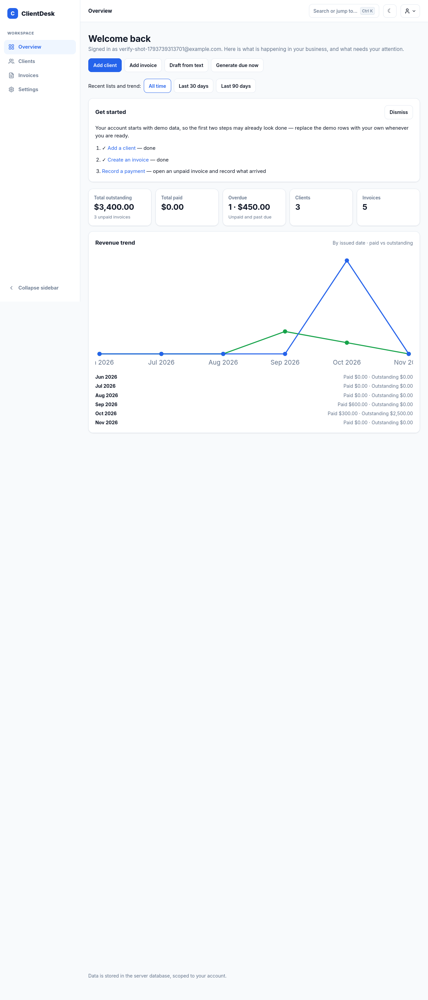
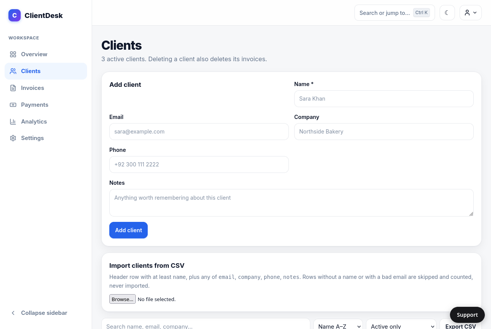
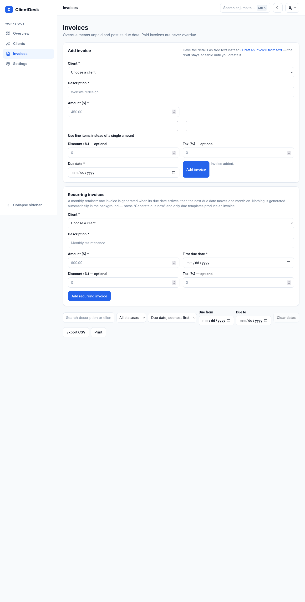
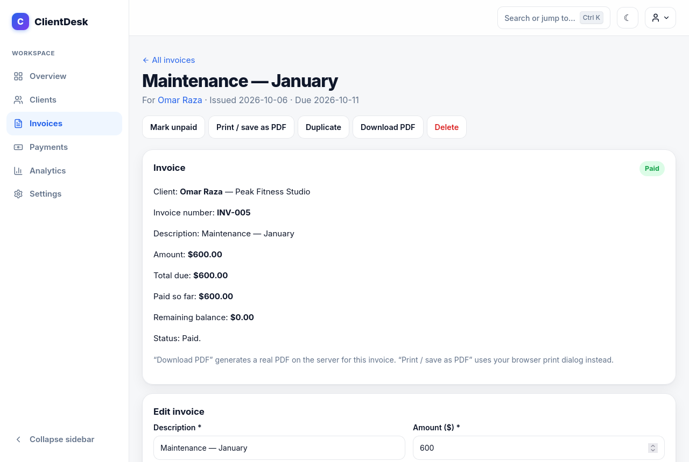

# ClientDesk

I kept losing track of freelance work in spreadsheets. Who owed what, what was
already paid, what was overdue — it was all over the place. So I built this
for myself, and kept it small on purpose.

ClientDesk is a small SaaS for freelancers: a client and invoice
manager with accounts, plans, and a public site. You sign up, add your
clients, add invoices, and you can see at a glance what is paid,
unpaid, and overdue. Each account only sees its own stuff. That's it,
really.

Visitors who aren't signed in see a landing page, a pricing page
(Free $0, Pro $9/month, Business $19/month), and plain-language terms
and privacy pages. Signing up starts you on Free with an onboarding
checklist on the dashboard: add a client, create an invoice, record a
payment. The demo data that comes with a new account already covers
the first two, and the checklist says so.

Built in October 2026, mostly with Next.js and TypeScript. I was learning
Prisma and auth as I went, so some parts are cleaner than others. In
November 2026 I redesigned the whole app (the 2.0 look: Inter type, a
blue theme, softer cards, small animations), added a support chat that
answers from the app's own help pages, added Zapier webhooks, and made
pages show a loading spinner instead of a blank screen while the
server wakes up.

## What you can do

Sign up with an email and a password (8 characters minimum). Passwords are
hashed, sessions are stored in the database and sent back as an httpOnly
cookie. Google and GitHub sign-in are built too, but not switched on —
they need API credentials I haven't added yet. No demo account — you
have to make your own.

On the dashboard you get your totals: outstanding, paid, overdue, and your
recent invoices. The overdue and outstanding figures use what's actually
left after part-payments, not the full invoice amounts. The stat cards fade in a bit as you scroll. I used GSAP
for that. Turn on reduced motion and it just doesn't animate. If GSAP
fails to load, nothing disappears, the page still works.

Add clients, edit them, search them, delete them. If you delete a client,
their invoices go too. You can leave a short note on a client and it shows
under their name.

Invoices can be filtered by paid, unpaid, or overdue, and by a due-date
range, and searched by description or client name. Overdue just means
unpaid and past the due date, nothing clever. Mark an invoice paid or
unpaid, edit it, duplicate it for a repeat job, delete it, export the
filtered list as a CSV, print it, or download a real PDF of it.

Invoices have numbers (INV-001, INV-002, and so on) and can carry a
discount and a tax rate — discount comes off first, then tax is worked
out on what's left. You can set a business name in Settings and it
shows on the invoice page and the PDF. Invoices can also repeat
monthly: set one up once, then press "Generate due now" when it's due
and it makes one invoice and moves the next date a month on. Nothing
runs in the background.

Part-payments work too. Record what a client actually paid and when,
and the invoice shows paid so far and what's left. When the payments
reach the total it flips to paid by itself. Recorded a payment by
mistake? Delete it and the balance comes back. The invoices CSV
includes paid and balance columns, and each client's page and row in
the clients list show their outstanding balance.

When you first sign up you get three demo clients and five demo invoices,
so the pages aren't empty. The dates are set relative to today, so one of
them is always overdue. There is a "Reset demo data" button on the
dashboard. It wipes your clients and invoices and puts the demo ones back,
so be careful with it if you have real entries in there.

### Draft helpers (rule-based, not AI)

Three small helpers that draft things from your real data — every figure
in them comes from an invoice or a payment you already recorded, and
nothing they produce is saved until you confirm it:

- **Draft invoice from text** (Invoices → "Draft an invoice from
  text"): paste something like "Website work for Acme Studio, total
  $1200, due 2026-12-01" and it fills in the client, amount, and due
  date. The rules are simple on purpose: the largest $-marked amount,
  a YYYY-MM-DD or DD/MM/YYYY date, the longest client name found in
  the text. Anything it misses stays empty for you to fill in.
- **Reminder draft** on each unpaid invoice's page: a fixed template
  with that invoice's total, paid so far, balance, and days overdue.
  There is no send button — ClientDesk has no email service yet — so
  you copy it into your own email.
- **Dashboard summaries**: this month's billed, paid, and outstanding
  totals (plain arithmetic, no forecast), and a "largest outstanding
  balances" list that is a sort by outstanding amount, largest first —
  not a risk prediction.

### Plans and billing

Free allows 10 clients and 30 invoices (demo data counts toward both).
Pro and Business are unlimited. The billing code is built — Stripe
checkout, a signature-checked webhook that flips your plan, and a
customer portal for managing or cancelling — but it is **not switched
on yet**: Stripe isn't connected, so every account is on Free and the
Settings billing section says so plainly. No real money moves until
test-mode billing is switched on deliberately, and live payments are a
separate decision after that.

### Security and your data

Every response carries security headers, and cross-site mutation
requests to the API are rejected (the Stripe webhook is the one
exception, verified by signature). Password changes are rate-limited,
and `/api/health` reports whether the database answers, for uptime
monitoring. In Settings you can export everything in your account as
one JSON file — passwords, sessions and reset tokens are never
included — delete your whole account by typing your own email address
to confirm, and see a recent activity log of your own changes.

### Webhooks (Zapier)

In Settings you can add your own webhook URL — for example a
Catch Hook URL from Webhooks by Zapier — and pick which events it
receives. ClientDesk posts one JSON payload per event to that URL:

- `client.created` — `{ client: { id, name, email, company } }`
- `invoice.created` — `{ invoice: { id, number, description, amount, total, dueDate, issuedDate, status }, client: { id, name, email } }`
- `invoice.paid` — the same invoice shape, with `status: "paid"`
- `payment.recorded` — `{ payment: { id, amount, method, paidAt, reference }, invoice: { id, number, description, total, status } }`

Every payload is wrapped as `{ event, occurredAt, data }`, and the
invoice `total` is the discount-then-tax total, the same figure the
invoice itself shows. Each request carries an
`X-ClientDesk-Event` header with the event name and an
`X-ClientDesk-Signature` header — an HMAC-SHA256 of the raw body,
made with the secret shown once when you add the webhook. Only
`https://` URLs are accepted. A webhook that is down or slow never
breaks creating a client, invoice, or payment in ClientDesk.

To use it with Zapier: create a Zap with Webhooks by Zapier →
Catch Hook, copy the webhook URL, paste it in Settings, pick the
events, then press Test — it sends a sample payload labelled as a
test, and shows the status Zapier answered with.

### Support chat

Every page has a Support button (bottom right). It opens a chat that
answers questions from ClientDesk's own help pages — what the free
plan allows, how to export clients, how to reset a password — and
every answer names the page it came from. If it can't find an answer
it says so honestly and offers to open a ticket for a human instead
of guessing. The chat runs on a separate small app,
[clientdesk-support](https://github.com/MuhammadAhmad67889/clientdesk-support)
(live at https://clientdesk-support.vercel.app), which answers with a
free Groq model when its key is set and quotes the help pages
verbatim when it isn't. Tickets land in an admin inbox there, where a
human can reply and the reply shows back in the chat.

## How the code is organised

I wrote the code to be easy to read and easy to debug — small
functions with plain names, and comments only where they explain
*why* something is done a certain way, not what the code already
says. If you're reading it for the first time, start here:

- `src/app/` — one folder per page (`clients`, `invoices`,
  `settings`, …). Pages are server components: they check who is
  signed in, fetch that user's data, and hand it to a client
  component that renders the interactive bits. `loading.tsx` is the
  spinner every page shows while its data loads.
- `src/lib/data.ts` — the database calls for clients, invoices,
  payments, and sessions. Every query filters by the signed-in
  user's id, so accounts can't see each other's data.
- `src/lib/` — one file per idea, each with tests next to it:
  `invoices.ts` (totals, discount-then-tax maths), `billing.ts`
  (which Stripe status means Pro), `webhooks.ts` (Zapier payloads
  and signing), `auth.ts` (passwords and sessions), `plans.ts`
  (Free 10 clients / 30 invoices).
- `src/components/` — the pieces pages share: the sidebar shell,
  the forms, the command palette, the webhook form.
- `src/app/globals.css` — all the styling, in one file, as plain
  CSS variables (`--primary` is the blue). No component library.
- `prisma/schema.prisma` — the database tables. `prisma/migrations/`
  holds one folder per change, in date order.

Run `npm test` and you'll see the same shape: one test file per lib
file, named the same way (`invoices.test.ts` tests `invoices.ts`).

## How to run it

You need Node 20+ and npm, and Postgres running locally.

```bash
cp .env.example .env
# Open .env and put a long random string in AUTH_SECRET.
# DATABASE_URL and DATABASE_URL_UNPOOLED point at your local Postgres.
npm install
npx prisma migrate dev
npm run dev
```

Go to http://localhost:3000 and sign up. Don't commit `.env` — it's
ignored for a reason.

```bash
npm test         # unit tests
npm run lint
npm run typecheck
npm run build
npm start        # runs the production build
```

## How it's put together

Next.js with the App Router, TypeScript, plain CSS. I didn't use a
component library. GSAP is the only animation dependency.

The database is Prisma with Postgres, locally and in production. The schema is in
`prisma/schema.prisma`, migrations are in `prisma/migrations/`. Every
client and invoice query in `src/lib/data.ts` filters by the logged-in
user's id, so accounts can't see each other's data.

Pages are server components that check the session first, and the forms
call the `/api/*` routes, which check it again. Middleware rejects
cross-site mutation requests to `/api/*` (a browser sending an Origin
from another site), except the Stripe webhook, which Stripe's servers
post to and which is verified by signature instead. Session cookies
are verified on the server, not in middleware, because the Edge
runtime can't run the crypto code.

The maths and filtering stuff — totals, overdue dates, search, CSV,
validation — is in `src/lib/` with tests next to it. There's one test
that spins up a throwaway Postgres database and checks that one user
can't see or delete another user's data. That one took me a while.

CI runs when I push to `main` or open a pull request: migrate, lint,
typecheck, test, build, on Node 20 and 22. The secrets in the workflow
file are dummy values just for the tests.

## What's still rough

No email verification yet, and password reset by email is built but
not switched on — it needs an email service, which I haven't
configured. If you're signed in, you can change your password from
Settings instead, and it signs you out on your other devices. Billing
is built but not switched on (see Plans and billing above). The first
load after a pause is slow (about 2.5 seconds) because the free
database sleeps after 5 minutes idle — I deliberately don't ping it
awake, because the free plan only allows 100 compute-hours a month
and keeping it awake would use them up and get the database switched
off until next month. There are no projects, tasks, messages, or
reports pages, and no file attachments — I didn't invent those, so
the sidebar lists Overview, Clients, Invoices, Payments, Analytics,
and Settings.

## Screenshots

These are real screenshots of the deployed app, taken 11 November
2026 with the seeded demo data (not a real customer's data). They
show the current interface in the blue 2.0 design: dashboard with
revenue trend and recent activity, clients, invoices, and an invoice
detail page with line items and payment history.






## How I verified this

CI runs on every push to `main`: migrate, lint, typecheck, test, and
build on Node 20 and 22. The live checks I actually did: logged out,
`/` sends you to `/login`; signed up, added a client and an invoice,
reloaded, and both were still there.

The screenshots above are real shots of the deployed app with seeded
demo data, taken 11 November 2026 — not a real customer's data. They
show the current interface in the blue 2.0 design, including the
revenue trend, recent activity, line items, and payment history.

Verified live, 11 November 2026: the Zapier webhooks section shows in
Settings and accepts a Catch Hook URL; the support chat answers live
from the help pages; the blue theme and the small inline checkboxes
are live on the real site; pages show a loading spinner while the
server wakes up. The first load after a pause takes about 2.5 seconds
(the free database sleeps after 5 minutes idle) and warm loads take
under a second — see "What's still rough" for why I don't keep it
awake.

Data cleanup, 1 November 2026: the live database had picked up six
throwaway test accounts from verification and screenshot work (19
clients, 31 invoices between them). I deleted those six accounts;
their clients and invoices went with them. One other account that
signed up on 29 October was left alone, because I couldn't confirm it
was a test account. After the delete I re-checked: 1 account, 3
clients, and 5 invoices remained, and the live site still sends
logged-out visitors to `/login`.

## Deploying to Vercel (Postgres)

1. Get a Postgres database. I used a free Neon database from Vercel
   Storage (`clientdesk-postgres`, Singapore region).
2. Push the repo to GitHub.
3. In Vercel, add a new project and import the repo. Framework preset:
   Next.js. The build command (`npm run build`) runs
   `prisma migrate deploy` first, so the tables get created on deploy.
4. Connect the database to the project in Vercel Storage, so
   `DATABASE_URL` and `DATABASE_URL_UNPOOLED` are set automatically.
   Then set `AUTH_SECRET` (a long random string, different from your
   local one) in the project settings.
5. Deploy, then check it yourself: logged out, `/` should send you to
   `/login`. Sign up, add a client and an invoice, reload, and make
   sure both are still there.

## What I'd do next

- Switch on Stripe billing in test mode, then try a demo payment with a test card.
- Password reset by email, once there's an email service.
- Draft helpers that use a real language model (needs an API key) — the rule-based drafts above are the fallback if there's no key.

## Features added in November 2026

- 2.0 redesign: Inter type, blue theme, softer cards and shadows,
  hover lifts, a command palette, and a mobile bottom nav.
- Support chat on every page, answering from the help pages with
  sources, backed by a separate support app (Groq live mode).
- Zapier webhooks in Settings: client added, invoice created,
  invoice paid, payment recorded — signed, https-only, tested from
  the Settings page.
- A loading spinner on every page, so a slow first load never looks
  like a dead screen.
- A smaller, blue landing preview image (WebP, 28KB).

## Features added 30 October 2026

I kept building on the same app instead of starting over:

- Client pages: click a client to see their contact details, totals,
  and all their invoices.
- Invoice pages: open an invoice to see it on its own, mark it paid
  or unpaid, delete it, or print it — printing and choosing "Save as
  PDF" in your browser is how you got a PDF back then. A real
  server-generated PDF download came later.
- Settings: change your password while signed in (current password
  checked, other sessions signed out).
- Client CSV import: upload a CSV with a `name` header and optional
  email/company/phone/notes columns. Bad rows are skipped and counted,
  not silently dropped.
- Dashboard: a last-6-months view of paid vs outstanding, from real
  issued dates. No chart library, just bars — and no numbers that
  aren't in the database.

## License

MIT — see [LICENSE](LICENSE).
